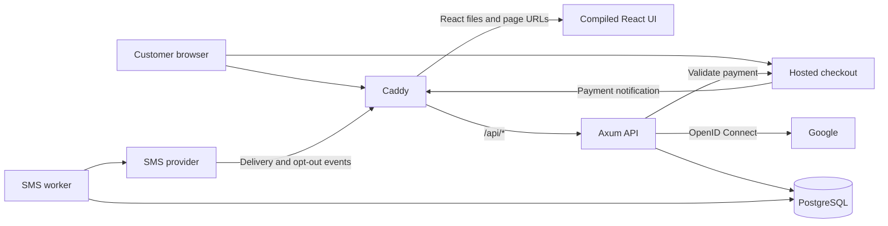

# SMS scheduling SaaS architecture

Payra has two applications in one repository. `ui/` is a React and TypeScript app built with Vite. `server/` is the Rust modular monolith. Its `serve` command runs the Axum API, `worker` submits scheduled messages, and `migrate` updates the database schema. These commands ship in one Rust image. Caddy serves the compiled React app over HTTPS and forwards API requests to Axum. PostgreSQL stores accounts, schedules, credits, and payment history.

See the [system design](system-design.md) for customer behavior, bundle rules, scheduling defaults, and launch checks.

## Runtime components



The React app renders pages and calls the API. Axum owns sessions, authorization, validation, and HTTP responses. The worker owns scheduled dispatch. The web and worker processes call application functions backed by SQLx. Payment and SMS adapters translate provider responses into local outcomes. Start with a fake SMS adapter and a clock you can set in tests. [Axum routing and state](https://docs.rs/axum/latest/axum/)

## Repository layout

```text
payra/
├── compose.yaml
├── docs/
├── deploy/
│   └── caddy/
│       ├── Caddyfile       HTTPS, React page fallback, and API proxy
│       └── Dockerfile      Builds React and copies its output into Caddy
├── server/
│   ├── .env.example       Local Rust settings template
│   ├── Cargo.toml
│   ├── Cargo.lock
│   ├── Dockerfile          Shared image for web, worker, and migrations
│   ├── migrations/        Versioned PostgreSQL schema changes
│   └── src/               Axum, business rules, and the worker
└── ui/
    ├── package.json
    ├── vite.config.ts
    └── src/               React application
```

## Local development

On a fresh checkout, copy the example settings and start PostgreSQL from the Payra root. Then start Axum from `server/` so it finds `server/.env`.

```bash
cp -i server/.env.example server/.env
docker compose up -d db
cd server
cargo run
```

In a second terminal, run `curl -i http://127.0.0.1:3000/health`. Expect `200 OK` when the server can query PostgreSQL. The local template connects to PostgreSQL through its published host port at `127.0.0.1:5432` and binds Axum to `127.0.0.1:3000`.

## Server layout

```text
server/src/
├── main.rs                Wires dependencies and starts the selected command
├── config.rs              Configuration module when startup settings grow
├── db.rs                  Creates the shared SQLx PostgreSQL pool
├── web.rs                 Combines routers and supplies shared web state
├── health.rs              Database-backed GET /health endpoint
├── auth.rs                Authentication module entry point
├── auth/
│   ├── routes.rs          Sign-in, callback, logout, and current-account endpoints
│   ├── google.rs          OpenID Connect redirect and token verification
│   └── sessions.rs        Session storage, lookup, and revocation
├── recipients.rs          Recipient records, consent, and opt-outs
├── scheduling.rs          Scheduling module entry point
├── scheduling/
│   ├── routes.rs          Message list, create, edit, and cancel endpoints
│   └── messages.rs        Scheduling rules, message SQL, and job transitions
├── billing.rs             Billing module entry point
├── billing/
│   ├── routes.rs          Bundle, order, balance, and payment endpoints
│   ├── orders.rs          Checkout orders, payment confirmation, and reconciliation
│   └── credits.rs         Credit grants, reservations, consumption, and releases
├── worker.rs              Polls for due jobs, attempts sends, and handles recovery
└── providers/
    ├── mod.rs             Declares the provider modules
    ├── payments.rs        Hosted checkout and gateway API calls
    └── sms.rs             Fake sender, live sender, and receipt verification
```

The initial server has four sibling files. `main.rs` loads `.env` before starting Tokio, reads `DATABASE_URL` and `BIND_ADDR`, and starts the listener. `db.rs` creates a pool that connects on demand. `web.rs` merges the health router and gives Axum the pool with `with_state`. `health.rs` registers the route and obtains the pool from Axum when a request arrives.

Create future feature files when you build those features. A feature can expose `routes()` from a single file and keep that entry point when it grows a directory.

Each HTTP feature exposes a small router. A handler reads the request and authenticated account, calls the feature function, and maps its result to HTTP. Keep SQL close to the feature that owns it. For example, scheduling creates the message and calls billing to reserve a credit inside the same transaction. The worker calls scheduling to claim and settle a job, and calls the SMS adapter to talk to the provider.

## UI layout

Use `ui/src/app/router.tsx` for the React Router route table and `ui/src/app/layouts/` for shared page layouts. Put URL-level pages in `ui/src/routes/`, feature-specific forms and API calls in `ui/src/features/`, and reusable controls and HTTP helpers in `ui/src/shared/`. Build the UI after the API can be exercised independently. [React Router nested routes](https://reactrouter.com/start/data/routing#nested-routes)

Public pages include `/`, `/login`, and `/consent/:token`. The signed-in layout at `/app` hosts the dashboard, messages, recipients, and billing pages. It can direct a signed-out visitor to `/login`. Axum checks the session and ownership on every protected API request.

## HTTP and authentication

| Entry point | Contract |
| --- | --- |
| `GET /health` | Runs `SELECT 1` with a two-second timeout. Returns `200 OK` when PostgreSQL answers or `503 Service Unavailable` on a query failure or timeout. |
| `GET /api/auth/google`, `GET /api/auth/google/callback` | Start OpenID Connect, verify the callback, establish a session, and redirect to the React app. |
| `POST /api/logout`, `GET /api/me` | End the session and read the current account. |
| `GET /api/recipients`, `POST /api/recipients` | List account recipients or add a recipient and create a consent invitation. |
| `GET /api/consent/{token}`, `POST /api/consent/{token}` | Load invitation details for the public consent page and record a recipient's decision. |
| `GET /api/messages`, `POST /api/messages` | List account messages or reserve a credit and schedule a message. |
| `PATCH /api/messages/{id}`, `POST /api/messages/{id}/cancel` | Edit a queued message or cancel it and release its credit. |
| `GET /api/billing/bundles`, `GET /api/billing/balance` | List available bundles and read the account's credit balance. |
| `GET /api/billing/orders`, `POST /api/billing/orders`, `GET /api/billing/orders/{id}` | List orders, start hosted checkout, and read the status of an account's order. |
| `POST /api/billing/return` | Receive the gateway's browser return and redirect to the React order page. |
| `POST /api/webhooks/payments`, `POST /api/webhooks/sms` | Verify payment notifications and authenticate SMS provider events. |

Use a maintained OpenID Connect library. Check the callback state and token claims, including issuer, audience, expiry, and nonce. Use Google's stable subject identifier for the local account. Issue an opaque, expiring app session in a `Secure`, `HttpOnly`, `SameSite=Lax` cookie in production, and invalidate it on logout. Protect browser mutations with CSRF checks. Provider callbacks authenticate through their own verification flow. [Google OpenID Connect](https://developers.google.com/identity/openid-connect/openid-connect), [OWASP session management](https://cheatsheetseries.owasp.org/cheatsheets/Session_Management_Cheat_Sheet.html), [OWASP CSRF prevention](https://cheatsheetseries.owasp.org/cheatsheets/Cross-Site_Request_Forgery_Prevention_Cheat_Sheet.html)

Derive `account_id` from the session for every customer query. For example, a cancellation matches both the URL's message ID and the session's account ID. Composite foreign keys protect ownership relationships in PostgreSQL. A consent link uses a random, expiring token tied to one recipient, with only its digest stored in the database. Opening the link loads the consent page. Record the decision only after a POST so a link preview cannot opt someone in. [PostgreSQL constraints](https://www.postgresql.org/docs/current/ddl-constraints.html)

## PostgreSQL model

| Table | Key fields and constraints |
| --- | --- |
| `accounts` | Internal ID, unique Google subject, display name, email, preferred time zone, sending hold status. |
| `sessions` | Session token digest, account ID, expiry. |
| `recipients` | Account ID, ID, normalized phone number, active flag, consent status, consent timestamp and evidence reference, invitation digest and expiry. Unique `(account_id, phone_e164)` and `(account_id, id)`. |
| `sms_suppressions` | Sending identity, normalized phone number, opt-out timestamp. Unique `(sender_key, phone_e164)`. |
| `scheduled_messages` | Account ID, recipient ID, rendered body, time zone, `send_at`, `expires_at`, `next_attempt_at`, submission and delivery status, claim token and lease deadline, attempt count, provider message ID. Composite FK `(account_id, recipient_id)` and unique submission key within the account. |
| `sms_delivery_events` | Verified event key, provider message ID, status, timestamps. Keep unmatched receipts until the dispatch result links them to a message. |
| `bundles` | Bundle code, label, positive credit quantity, positive price in BDT minor units, active flag. |
| `payment_orders` | Account ID, bundle code, price and credit snapshots, unique merchant transaction ID, gateway transaction reference, status. A confirmed gateway transaction can settle only one order. |
| `credit_balances` | Account ID, available and reserved credits as nonnegative integers. One row per account. |
| `credit_ledger` | Account ID, available and reserved deltas, event kind, linked order or message ID, timestamp, unique event key. Enforce one purchase grant per order and one settlement per message. |

Use `timestamptz` for scheduled instants, retry deadlines, and event times. Index scoped history by account and time. Use a partial index on `(next_attempt_at, id)` for messages in the scheduled state, plus an index for expired sending leases. Compare gross checkout amounts as integers in minor units or as exact decimals when parsing gateway values. [PostgreSQL timestamp types](https://www.postgresql.org/docs/current/datatype-datetime.html)

## Transaction and retry boundaries

**Schedule or cancel.** Lock the account's balance row. For creation, validate eligibility and available credit, insert the message, and write the reservation and updated balance in one transaction. A form submission key unique within the account lets a repeated request return the original schedule. For cancellation, conditionally transition a scoped scheduled row and release only if that transition succeeds. Use balance-row-then-message-row lock order when both are needed. [PostgreSQL row locks](https://www.postgresql.org/docs/current/explicit-locking.html#LOCKING-ROWS)

**Apply a payment.** Validate with the provider outside the database transaction. Inside the transaction, lock the account balance, confirm the saved order still matches, and write the order update, ledger grant, and balance together. A unique purchase event makes replay safe. Keep cancellation and success redirects informational. A reconciliation job checks old pending orders through the gateway so notification delivery is not the only recovery path. [SSLCOMMERZ order validation and transaction lookup](https://developer.sslcommerz.com/doc/v4/)

**Claim and submit.** In a short transaction, select one due scheduled row with `FOR UPDATE SKIP LOCKED`, then mark it sending with a fresh claim token and lease deadline. Commit before contacting the provider. Check consent, suppression, account holds, and expiry before the call. Enforce account-wide and global send limits with atomic counter updates before dispatch. Require enough lease time for the bounded provider call and record the result only for that claim. A confirmed temporary rejection can reschedule the same job with bounded backoff. Expiry releases the credit when non-acceptance is known. [PostgreSQL queue-style row locking](https://www.postgresql.org/docs/current/sql-select.html)

**Recover and reconcile.** Expire overdue queued jobs and release their reservations. Move interrupted sending jobs with expired leases to unknown and retain their reservations. Resolve an unknown job from provider evidence, including a late result from the same claim if it is still current. When a provider offers a documented idempotency key for message creation, reuse the job's stable key. Store verified delivery receipts before acknowledging them, then apply them once their provider message ID is known. Duplicate or out-of-order receipts must preserve the recorded terminal status.

## Docker and VPS

- In development, run Axum locally and configure Vite to proxy `/api` to it. In production, build React in the Caddy Dockerfile and copy the output into the Caddy image. Caddy forwards `/api/*` to Axum with the path intact. It serves static assets and uses `index.html` for React page URLs so a direct visit to a route like `/app/messages` works. The React app and API share one public origin. [Vite dev proxy](https://vite.dev/config/server-options.html#server-proxy), [Caddy SPA routing](https://caddyserver.com/docs/caddyfile/patterns#single-page-apps-spas)
- Run `caddy`, `web`, `worker`, and `db` in Compose. Run migrations as a one-shot command before starting the two Rust services. Use a PostgreSQL health check and service DNS at `db:5432`. Publish the HTTPS entry point through Caddy and keep the other services on the Compose network. [Compose startup order](https://docs.docker.com/compose/how-tos/startup-order/), [Compose networking](https://docs.docker.com/compose/how-tos/networking/), [Caddy automatic HTTPS](https://caddyserver.com/docs/automatic-https)
- On the VPS, configure the Rust services with `env_file: ./server/.env` in the root Compose file. Use `db:5432` in the production database URL and set `BIND_ADDR=0.0.0.0:3000` so Caddy can reach Axum. When the Rust image uses `./server` as its build context, exclude `.env` with `server/.dockerignore`. [Compose environment files](https://docs.docker.com/compose/how-tos/environment-variables/set-environment-variables/#use-the-env_file-attribute), [Docker build context](https://docs.docker.com/build/concepts/context/#dockerignore-files)
- Use a multi-stage image with a non-root runtime user. Inject Google, payment, SMS, and database credentials at runtime. Keep the database and Caddy data on persistent volumes. Back up PostgreSQL off the VPS and test a restore. [Docker multi-stage builds](https://docs.docker.com/build/building/multi-stage/), [PostgreSQL backups](https://www.postgresql.org/docs/current/app-pgdump.html)
- Log internal IDs and state transitions. Track the age of the oldest due job, unknown sends, overdue pending payments, and failed submissions. Keep message bodies, full phone numbers, tokens, and gateway secrets out of logs, including token-bearing URLs in proxy logs. Use bounded provider timeouts and graceful shutdown so the worker stops taking new jobs before exiting.

## Build milestones

| Milestone | Exercise | Done when |
| --- | --- | --- |
| 1. Axum and Google | Use the existing Axum modules and PostgreSQL pool. Build Google sign-in and `GET /api/me`, then trace the callback and session lookup. | `GET /health` reports whether Axum can query PostgreSQL, and two Google users have separate local accounts. |
| 2. One scheduled text | Write the first scheduling queries in `psql`, then call them through SQLx. Run `worker --once` with a fixed clock and fake sender. | A queued test message reaches the fake sender and appears in account-scoped history. |
| 3. Credits and concurrency | Seed test credits. Implement the ledger and balance transaction, cancellation, and worker claims. Run two concurrent requests for the last credit. | One reservation wins, cancellation releases it once, and two workers cannot both claim a job. |
| 4. Wallet checkout | Connect sandbox checkout. Exercise successful, failed, mismatched, and duplicate notifications. | One verified order creates one credit grant. The dashboard can show an order while confirmation is pending. |
| 5. Live SMS and VPS | Add verified provider callbacks, consent enforcement, send limits, and the production Compose deployment. Test cancellation, opt-out, provider timeout, and restart recovery. | A real purchase and send work on the VPS and a backup can be restored into a separate database. |
