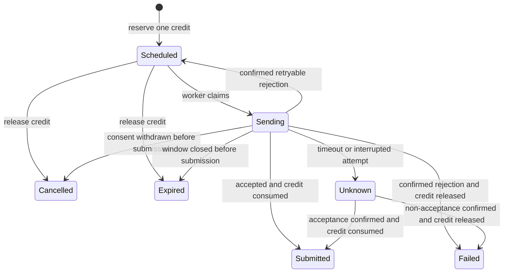

# SMS scheduling SaaS system design

The service lets customers sign in with Google, buy a bundle through bKash or Nagad, and schedule a text. The customer chooses the recipient, writes the message, and picks a local date, time, and time zone. The React dashboard shows upcoming texts, available and reserved credits, payment history, and delivery status. It reads that data from the Axum API.

See the [architecture](architecture.md) for the Axum modules, SQL transactions, deployment, and build milestones.

## First release

| Area | Behavior |
| --- | --- |
| Accounts | The first Google sign-in creates a personal account. Each account owns its recipients, schedules, orders, and credit balance. |
| Scheduling | One recipient, one short SMS, and one send time per schedule. Customers can edit or cancel queued messages. |
| Bundles | Small, Mid, and Large are one-time purchases. Each adds a fixed number of credits to the same balance. Customers can buy another full bundle at any balance. |
| Payments | Customers pay in BDT through bKash or Nagad on hosted checkout. A verified payment grants credits. |
| Delivery | The dashboard distinguishes provider acceptance from a delivery receipt and shows when a message needs attention. |

The example pack sizes are **25, 100, and 500 credits**. Quantities and prices are configurable. Confirm SMS costs and gateway fees before setting live prices. Credits from multiple purchases share one balance and remain available until used or refunded.

One credit covers one SMS segment, including any sender identification or opt-out text added to the message. The editor previews the length and the server validates the final encoded body. Bangla, emoji, and some punctuation can change how much text fits in one segment. Validate against the chosen SMS provider's encoding behavior before launch. [SMS encoding and segmentation](https://www.twilio.com/docs/glossary/what-sms-character-limit)

A birthday greeting and an appointment reminder use the same scheduler. Yearly repetition is a later milestone. Each occurrence will create its own scheduled message and reserve a credit when it is queued.

## Scheduling rules

- Default the time zone selector to the customer's saved preference, initially `Asia/Dhaka`. Store the chosen IANA time zone alongside the resolved `send_at` instant. If a local time occurs twice, ask the customer to pick an offset. If it does not occur, ask for another time. [PostgreSQL date and time types](https://www.postgresql.org/docs/current/datatype-datetime.html)
- The first worker polls every 15 seconds and submits due messages as capacity permits. Its initial late-send window is 15 minutes. Store a send-by instant on each job so a restart can pick up jobs still inside their window and expire older ones. Carrier delivery time is separate from submission time.
- Queue only for an active, opted-in recipient. The account owner shares an invitation link through an existing channel. Record consent for that account and phone number through a flow accepted by the SMS provider. Replacing a phone number deactivates the old recipient entry and creates a new entry that needs consent. Apply provider opt-outs to every affected recipient and recheck consent and suppression before dispatch. [Example SMS provider messaging policy](https://www.twilio.com/en-us/legal/messaging-policy)
- A queued text can be edited or cancelled until a worker claims it. An edit revalidates the final body, consent, and time. It retains the existing reservation because each scheduled text costs one credit. Cancellation releases that reservation.

## Credit lifecycle

The credit ledger is an append-only record of changes. A balance row holds the current available and reserved totals. Update both inside the same PostgreSQL transaction. The balance must stay nonnegative and match the sum of ledger changes.

| Event | Available change | Reserved change |
| --- | ---: | ---: |
| Verified purchase of a bundle of `n` credits | +n | 0 |
| Queue one message | −1 | +1 |
| Provider accepts the message | 0 | −1 |
| Queued message cancelled, expired, or definitively failed before acceptance | +1 | −1 |
| Provider outcome is unknown | 0 | 0 |

For example, after buying 25 credits and scheduling three texts, a customer has 22 available and three reserved. Cancelling one gives them 23 available and two reserved. Once the provider accepts a text, that reservation is consumed even if the carrier later reports it undelivered. Show this rule alongside the balance and send history.

Each purchase grants credits once. Each message gets one reservation and one eventual settlement, either consumption or release. Retries retain the original reservation. An unknown outcome stays reserved until the provider or an operator can establish whether the SMS was accepted. Link each verified refund or reversal to its original order and apply the corresponding ledger adjustment once. If the available balance is insufficient, keep the adjustment pending and pause scheduling and sending for that account until an operator resolves it.

## Payment lifecycle

1. Create a pending order with the account, bundle code, credit count, price in BDT minor units, and a unique merchant transaction ID. Snapshot the amount and quantity so catalog edits do not change an existing order.
2. Create a hosted checkout session and redirect the customer. After checkout, Axum directs the customer back to the React order page. The page reads the order status through the account-scoped API.
3. The backend validates the gateway notification or checks the order through the gateway API. It matches the transaction ID, gross order amount, currency, and accepted status. A gateway risk flag keeps the order under review.
4. In one database transaction, finalize the verified order, append the credit grant, and update the balance. Duplicate or concurrent confirmations resolve to the same purchase. Reconcile older pending orders if a notification is delayed or missed.

SSLCOMMERZ is the sandbox candidate. Confirm that both bKash and Nagad are enabled for the live merchant account. Keep the SMS provider open until sender approval, Bangladesh delivery support, opt-out handling, and message-status reporting are verified. [SSLCOMMERZ payment channels](https://sslcommerz.com/pricing/), [SSLCOMMERZ integration and validation](https://developer.sslcommerz.com/doc/v4/)

## Message lifecycle

Keep delivery status separate from submission state. After submission, a provider receipt can mark the SMS delivered or undelivered. A retry is eligible only after a definite temporary rejection and only within the send window. Reconcile unknown attempts before attempting another provider call. A database transaction can prevent two workers claiming the same job, but an SMS provider can accept a request before the worker records the result. [Example SMS delivery lifecycle](https://www.twilio.com/docs/messaging/guides/outbound-message-status-in-status-callbacks)

## Launch checks

- Two customers can sign in with Google, and each can access only their own recipients, orders, balances, and messages.
- Both wallets complete a real test checkout after sandbox testing. Duplicate confirmations grant one bundle. Cancelled payments and mismatched amounts grant zero credits.
- With one credit left, two concurrent scheduling requests produce one scheduled text. Cancellation restores the credit once.
- A test SMS reaches an opted-in phone. An opted-out recipient results in zero provider submissions. Accounts and the application have send limits.
- Restarting the VPS preserves balances, schedules, and history. A queued message can resume within its send window. An interrupted provider attempt appears as unknown for reconciliation.
